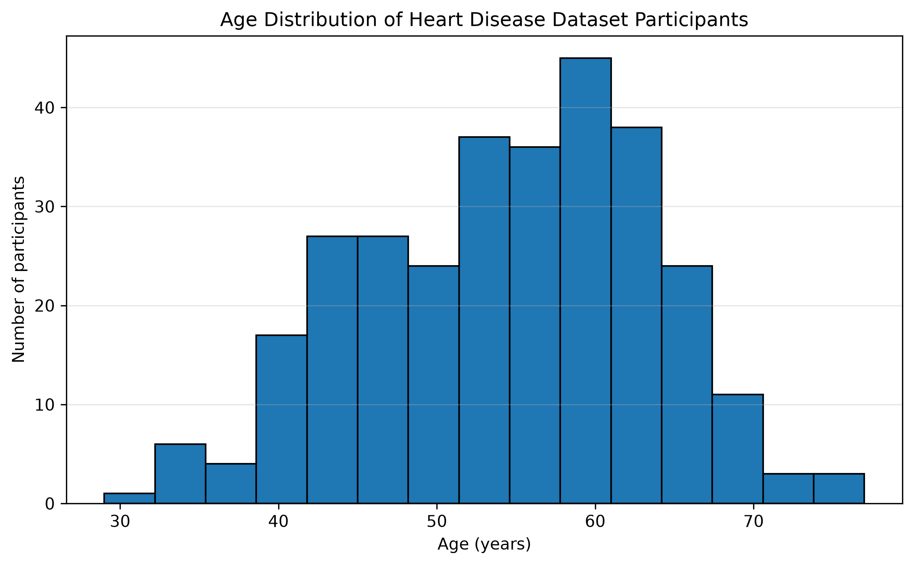
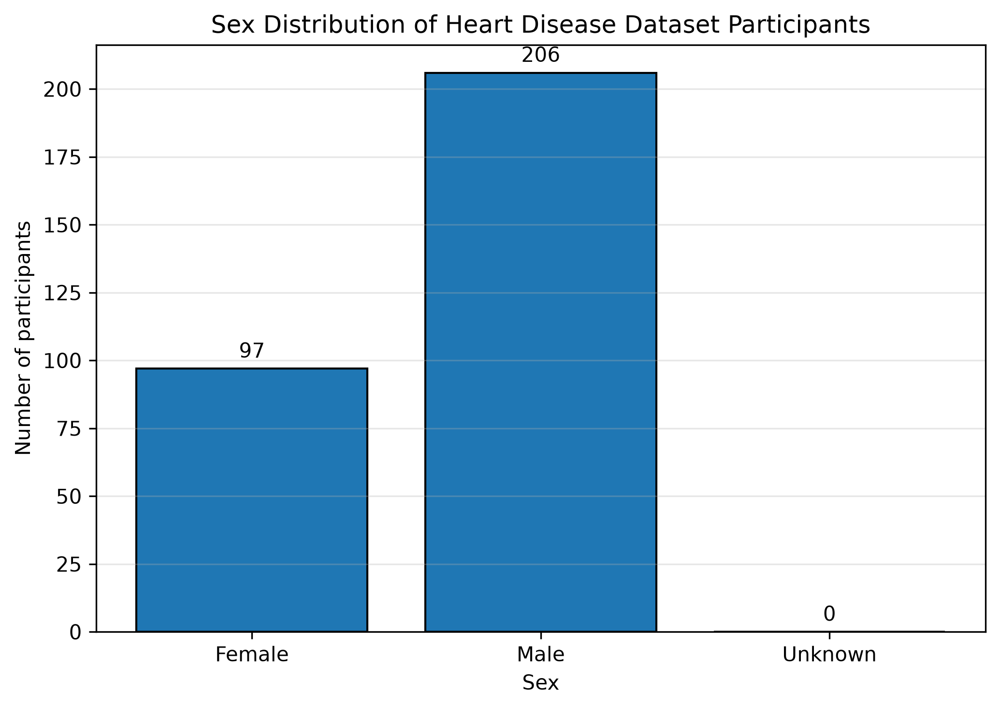

# UCI Heart Disease: Exploratory and Predictive Data Analysis


## 1. Project Overview

This project investigates the UCI Heart Disease dataset through a structured data analytics workflow, progressing from data acquisition and descriptive statistics to comparative analysis, correlation analysis, diagnostic investigation, and predictive modelling.

The project is being developed as a hands-on learning exercise using Python, Jupyter Notebook, pandas, statistical libraries, and machine learning tools.

The objective is to build a transparent and reproducible analytical workflow in which every conclusion is supported by observed data and documented methods.

## 2. Research Questions

The analysis will progressively investigate the following questions:

1. What are the demographic and clinical characteristics of the participants?
2. How do participant characteristics differ across recorded heart disease outcome groups?
3. Which variables are associated with one another, and how strong are these associations?
4. Which patterns and statistical relationships warrant further investigation?
5. How well can selected machine learning models predict the recorded heart disease outcome?
6. Which variables contribute most to model predictions, and how reliably do the models perform on unseen data?

These questions will be refined as the data structure and outcome coding are examined.

## 3. Dataset

**Dataset:** Heart Disease  
**Repository:** UCI Machine Learning Repository  
**Dataset ID:** 45

Official source:
https://archive.ics.uci.edu/dataset/45/heart+disease

The dataset is accessed using the `ucimlrepo` Python package.

The current analysis uses 303 observations. The available variables, their definitions, missingness, and outcome coding will be documented as the project develops.

The dataset is used for educational and analytical purposes. Its sampling characteristics and limitations must be considered before generalising findings.

## 4. Analytical Roadmap

The project will proceed through the following stages.

### Stage 1: Data Acquisition and Inspection

**Status: Completed / verify against notebook**

- Retrieve the dataset from the UCI repository.
- Inspect the returned dataset object.
- Separate feature variables and the target.
- Examine dimensions and variable names.

### Stage 2: Descriptive Analysis

**Status: Initial analysis completed**

- Calculate summary statistics for age.
- Summarise the sex distribution.
- Generate an age histogram.
- Generate a sex distribution bar chart.
- Save tables, figures, and a written report.

Current findings:

- Number of participants: 303
- Mean age: 54.44 years
- Standard deviation of age: 9.04 years
- Median age: 56 years
- Observed age range: 29–77 years
- Female participants: 97 (32.01%)
- Male participants: 206 (67.99%)

These results describe the dataset analysed and are not estimates of the general population.

### Stage 3: Comparative Analysis

**Status: Planned**

Potential analyses:

- Compare age distributions across recorded outcome groups.
- Compare outcome frequencies across sex categories.
- Select appropriate statistical tests based on variable types, distributions, assumptions, and group sizes.
- Report effect sizes and uncertainty where appropriate.

The final comparisons and tests will be chosen after inspecting the data and defining the relevant questions.

### Stage 4: Correlation Analysis

**Status: Planned**

Potential analyses:

- Examine relationships among numerical variables.
- Calculate suitable correlation coefficients.
- Visualise relationships using scatterplots and correlation heatmaps.
- Distinguish correlation from causation.

The choice of Pearson, Spearman, or another measure will depend on the variable types and analytical assumptions.

### Stage 5: Diagnostic Analysis

**Status: Planned**

Investigate patterns identified during earlier stages using appropriate statistical methods.

Possible activities include:

- Assessing relationships between candidate variables and the recorded outcome.
- Fitting interpretable statistical models where appropriate.
- Examining model assumptions, residuals, influential observations, and uncertainty.
- Evaluating alternative explanations and potential confounding.

Diagnostic findings will be interpreted as evidence of statistical relationships, not automatically as proof of causal mechanisms.

### Stage 6: Predictive Analysis

**Status: Planned**

Develop and evaluate machine learning models for the recorded heart disease outcome.

Potential activities include:

- Verify outcome coding and define the prediction target.
- Establish a baseline model.
- Split the data into training and test sets appropriately.
- Build preprocessing and modelling pipelines.
- Compare suitable classification algorithms.
- Evaluate performance using appropriate metrics.
- Assess overfitting, class imbalance, calibration, and generalisation.
- Examine feature importance or other model interpretation methods.

Model selection and evaluation will account for the relatively small dataset and the risk of overfitting.

Predictions will be treated as educational model outputs, not as validated clinical diagnostic recommendations.

## 5. Current Visualisations

### Age Distribution



### Sex Distribution



Additional figures will be added here as the analytical stages are completed.

## 6. Current Report

The descriptive analysis report is available here:

[Read the descriptive analysis report](reports/descriptive_analysis_report.md)

Summary tables:

- [Age summary statistics](reports/age_summary_statistics.csv)
- [Sex distribution summary](reports/sex_distribution_summary.csv)

These files will be updated or supplemented as new analyses are completed.

## 7. Project Structure

```text
Heart_disease_data_analytics/
├── notebooks/
│   └── analysis.ipynb
├── figures/
│   ├── age_distribution.png
│   └── sex_distribution.png
├── reports/
│   ├── age_summary_statistics.csv
│   ├── sex_distribution_summary.csv
│   └── descriptive_analysis_report.md
├── requirements.txt
└── README.md
```

New notebooks, figures, tables, and reports may be added as the project grows. This structure will be revised when necessary to keep the workflow organised.

## 8. Technology Stack

- Python for analysis and modelling.
- pandas and NumPy for data manipulation.
- SciPy and statsmodels for statistical analysis.
- Matplotlib, seaborn, and Plotly for visualisation.
- scikit-learn for machine learning and model evaluation.
- Jupyter Notebook for interactive analysis.
- ucimlrepo for dataset acquisition.
- Git and GitHub for version control and project documentation.

The full package list is maintained in `requirements.txt`.

## 9. Reproducibility

### Requirements

- Python with the packages listed in `requirements.txt`.
- Jupyter Notebook support.
- Internet access when retrieving the dataset from UCI.

### Installation

Activate the Python environment you intend to use and install the dependencies:

```bash
python -m pip install -r requirements.txt
```

Open the project in Visual Studio Code, select the appropriate Python kernel, and run the notebook cells in order.

Dataset retrieval and any preprocessing steps should be documented in the notebook so that the results can be reproduced.

## 10. Limitations and Responsible Interpretation

- Findings apply to the analysed dataset and should not automatically be generalised to a wider population.
- The dataset's provenance, selection criteria, and variable definitions must be considered.
- Statistical associations do not establish causation.
- Small sample size may limit the reliability and generalisability of predictive models.
- Data leakage must be prevented during preprocessing and model evaluation.
- Predictive performance must be evaluated on data not used to fit the final model.
- Models developed for this project are educational and are not intended for clinical decision-making.

## 11. Progress Log

| Stage | Status | Outputs |
|---|---|---|
| Data acquisition and inspection | Initial work completed | Jupyter notebook |
| Descriptive analysis | Initial work completed | Figures, CSV tables, Markdown report |
| Comparative analysis | Planned | To be determined |
| Correlation analysis | Planned | To be determined |
| Diagnostic analysis | Planned | To be determined |
| Predictive analysis | Planned | To be determined |

This table will be updated as each stage is completed and reviewed.

## 12. Author

**Boaz Aine**  
MSc Bioinformatics  
Makerere University

## 13. Project Development

This is an evolving project. The README, reports, figures, and analytical workflow will be updated as new questions are investigated and additional results are validated.
